# 1. Product Requirements Document (PRD)

> Writing standard: keep this document direct, specific, and consistent with `14_WRITING_VOICE_AND_CODE_COMMENTS.md`. Keep assumptions separate from verified facts.
## 1.1 Document control

-   Product: College Developer Community Platform
-   Status: Draft baseline; validate open questions before irreversible
    decisions
-   Primary owner: Product owner / student community leadership
-   Technical owner: Assigned engineering lead
-   Intended audience: Product, design, engineering, security reviewers,
    college IT, coding IDE / AI coding agent

## 1.2 Executive summary

I want to build a professional, college-scoped developer community platform where
students can discover projects, publish work, find collaborators, ask
for help, contribute to existing codebases, receive mentorship, and
develop a credible record of contribution.

The website is the discovery, collaboration, workflow, and community
layer. GitHub remains the source of truth for repositories, branches,
pull requests, issues, releases, and code review.

The platform supports two valid project paths:

1.  **Independent project:** a student or team lists a project and uses
    their own repository or existing GitHub organization. Community
    review is not required to publish or work on it.
2.  **Community-supported project:** a project applies for review
    because it needs more structured help, a larger team, mentorship,
    launch support, testing, design, deployment assistance, or broader
    community attention. If accepted, it may be added to the college's
    curated GitHub Organization and becomes eligible to request support.
    Acceptance does not guarantee every requested resource.

The platform is not a replacement for GitHub, a mandatory gatekeeper for
open source, a code execution service, or a popularity contest.

```mermaid
flowchart LR
    subgraph Onboarding ["1. Access & Verification"]
        Login["GitHub Sign-In"] --> CheckStatus{"Campus Verified?"}
        CheckStatus -->|No| Modal["Submit PRN / Roll No / Dept"]
        Modal --> Review["Admin Review Desk"]
        Review -->|Approved| Verified["Campus Verified Badge"]
    end

    subgraph Discovery ["2. Discovery & Collaboration"]
        CheckStatus -->|Yes| Directory["Campus Project Directory"]
        Verified --> Directory
        Directory --> SelectTask["Filter by Dept & Claim Task"]
        SelectTask --> Pitch["Submit Structured Pitch"]
        Pitch --> Maintainer["Maintainer Accepts Proposal"]
    end

    subgraph Execution ["3. Mentorship & Verification"]
        Maintainer --> Code["Ship PR on GitHub"]
        SelectTask -.-> Mentor["1-on-1 Mentor Guidance"]
        Code --> Merge["PR Merged"]
        Merge --> Receipt["Verified Contribution Receipt"]
    end
```

## 1.3 Problem statement

Students often build projects in isolation. Useful projects can stall
because contributors cannot find them, teams cannot discover relevant
skills, maintainers lack help, newcomers do not know how to start, and
abandoned projects have no structured handover path. Existing GitHub
activity alone does not provide a complete college-specific discovery
and support workflow.

The platform should reduce the friction between: - having an idea and
finding collaborators; - finding a project and making a first useful
contribution; - needing help and finding a suitable mentor; - building
independently and requesting structured community support; - doing
meaningful work and demonstrating that work credibly.

## 1.4 Vision

My goal is to create a trusted, searchable home for the college's developer community. A project should be able to start as an idea, find its first contributors, grow with the right support, and continue even when its original team graduates or moves on.

## 1.5 Product principles

These principles are the standard I want the product to follow as features are added. If a proposed feature conflicts with them, document the trade-off and ask for a decision instead of quietly changing direction.

1.  **Open participation:** listing a project or contributing to open
    source does not require organization admission.
2.  **GitHub-first code workflow:** do not duplicate Git hosting, issue
    tracking, or pull-request review unnecessarily.
3.  **Evidence over popularity:** reputation must use verifiable
    contribution evidence and contextual feedback.
4.  **Clear ownership:** distinguish project ownership, platform roles,
    and GitHub repository permissions.
5.  **Safe by default:** private data is private; actions are authorized
    on the server; webhook events are verified.
6.  **Progressive commitment:** idea-stage projects are welcome; project
    maturity is visible rather than used to exclude people.
7.  **Human accountability:** community admission, moderation, ownership
    transfer, and appeals have accountable decision-makers.
8.  **Accessible and mobile-friendly:** core flows must work with
    keyboard, screen readers, and narrow screens.
9.  **Maintainable simplicity:** use a modular monolith until measured
    needs justify additional services.
10. **Documented truth:** documentation must match actual implementation
    and deployment.

## 1.6 Goals and non-goals

### Goals

-   Let eligible college community members create profiles and discover
    projects.
-   Support projects at idea, prototype, active, maintenance, paused,
    and archived stages.
-   Allow project owners to state needs, roles, skills, tasks, and
    contribution instructions.
-   Support collaboration requests and contributor applications.
-   Provide a structured application/review/admission flow for
    community-supported projects.
-   Integrate GitHub metadata and contribution evidence with appropriate
    consent and permissions.
-   Create useful profiles that summarize verified contributions, skills
    demonstrated, mentorship, and collaboration.
-   Provide moderation, reporting, audit trails, and administrator
    controls.
-   Run reliably on a college-managed Linux server for an initial
    300--500 student community.
-   Provide automated tests, operational runbooks, and maintainable
    documentation.

### Non-goals for initial release

-   Hosting Git repositories or replacing GitHub.
-   Executing arbitrary student code, builds, containers, or
    deployments.
-   Guaranteeing that accepted projects receive mentors, funding,
    deployment, or promotional support.
-   Ranking students solely by commits, PR count, stars, followers, or
    raw activity.
-   Building a general-purpose social network with infinite feeds,
    public DMs, or viral engagement mechanics.
-   Microservices, Kubernetes, multi-region failover, or a complex event
    streaming platform without demonstrated need.
-   Automatically transferring repository ownership without explicit
    authorized approval.
-   Automatically making private repository data public.
-   Guaranteeing that GitHub contribution data is complete for every
    user's entire history.

## 1.7 Users and personas

### Student contributor

Wants to discover beginner-friendly tasks, understand setup
requirements, contribute to real projects, and build evidence of skills.

### Project owner / maintainer

Wants to publish a project, explain its purpose and status, recruit
teammates, list needs, review collaboration requests, and maintain
project health.

### Idea-stage founder

Has a problem or concept but little or no code. Wants feedback,
co-founders, design help, technical guidance, or validation.

### Mentor / experienced developer

Wants to help with architecture, code review, project direction, career
learning, or technical decisions without becoming responsible for every
project.

### Community reviewer

Reviews applications for the college-supported project program using
published criteria, documented decisions, conflict-of-interest handling,
and clear next steps.

### Platform administrator

Manages eligibility, user reports, platform configuration, access
controls, security incidents, and audit records.

### College IT administrator

Owns or supports server operations, domain/DNS, firewall, TLS, backup
destination, system updates, and recovery access.

## 1.8 Core user journeys

### Journey A: Join and establish identity

1.  User opens the platform.
2.  User signs in via GitHub OAuth (bypassing mandatory institutional `@isquareit.edu.in` domain email requirements so students can use their active developer profiles).
3.  The platform enforces the **Campus Identity Verification Gate**:
    - **Students:** verify college affiliation by submitting University PRN, Class Roll Number, Academic Year (FE, SE, TE, BE), and Department (Computer Engineering, Information Technology, or E&TC).
    - **Faculty / Mentors:** verify affiliation by submitting official College Employee Code, Academic Designation, and Department.
4.  Admin or faculty reviewer validates credentials in the Admin Verification Desk and updates status to `VERIFIED` (or requests revisions with specific feedback).
5.  User completes their developer profile with skills, interests, availability, and preferred contribution areas.
6.  User can edit public profile fields and manage project showcases.

Acceptance: - Unverified users can browse projects and roadmaps, but cannot create projects, claim tasks, pitch solutions, or message mentors. - Dual verification tracks cleanly isolate student PRNs from faculty employee codes. - Unique constraints on PRN prevent multiple accounts claiming the same college identity. - OAuth state and redirect validation prevent account-linking attacks. - Secrets never appear in client-side code or logs.

### Journey B: Publish an independent project

1.  User creates a project.
2.  User enters name, summary, problem, status, project type, skills,
    repository URL (optional for idea stage), contribution guidance,
    license (when known), and current needs.
3.  User selects whether the listing is public to the college community.
4.  Platform validates fields and ownership.
5.  Project appears in discovery according to visibility and status.
6.  Owner can update project details, invite collaborators, and archive
    the listing.

Acceptance: - A project can be listed without a GitHub repository if it
is at idea stage. - A project does not need admission to the college
GitHub Organization. - Repository URLs are validated and normalized;
arbitrary URLs are not fetched server-side. - Owners can correct or
archive listings without losing historical contribution attribution.

### Journey C: Discover and contribute

1.  User filters/searches projects by status, topic, skills, help
    needed, maturity, and contribution difficulty.
2.  Project page explains purpose, status, team, repository, license,
    setup steps, tasks, and how to contribute.
3.  User opens the relevant GitHub issue/PR or submits a collaboration
    request.
4.  Project maintainer reviews the request and accepts, declines, or
    asks for more information.
5.  Work is performed using the project's documented workflow and GitHub
    repository.
6.  Platform records relevant project participation and, when available,
    verified GitHub events.
7.  User and maintainer can provide structured feedback under the
    approved feedback policy.

Acceptance: - The platform never claims a GitHub PR is merged unless
that state is verified from GitHub data. - Applications and private
notes are visible only to authorized people. - Duplicate submissions and
webhook retries do not create duplicate contribution records.

### Journey D: Apply for community support

1.  Project owner opens an application for community support.
2.  Owner explains the problem, target users, current maturity, expected
    outcomes, repository/ownership status, requested support, team,
    risks, and next milestone.
3.  Reviewers assess the application using published criteria.
4.  Review may request changes, approve, decline, or defer.
5.  Decisions include rationale, reviewer identity, timestamp, and
    actionable next steps.
6.  For accepted projects, authorized maintainers coordinate the
    repository's admission to the college GitHub Organization where
    appropriate.
7.  The project becomes eligible to request support such as mentors,
    design/testing help, contributor recruitment, launch planning, or
    deployment guidance.
8.  Support requests are tracked separately; admission is not a
    guarantee of resources.

Acceptance: - Application status is visible to the owner and authorized
reviewers. - Rejection is not a ban on open-source development or
independent listing. - Repository transfer/admission requires an
explicit ownership, license, permissions, and continuity checklist. -
Conflicts of interest are disclosed and handled. - All decisions are
auditable.

### Journey E: Rescue or hand over a stalled project

1.  A user flags a project as stalled or requests a maintainer handover.
2.  Platform prompts for evidence and attempts to notify existing
    maintainers.
3.  Current owner can respond, archive, transfer maintainership, or
    request help.
4.  If the owner is unreachable, a documented community process
    determines whether any platform-level status can change.
5.  GitHub repository ownership is never transferred solely because a
    platform moderator labels the project abandoned.
6.  A new maintainer obtains access only through the repository's
    authorized owner / organization administrators.
7.  All decisions and contact attempts are recorded.

Acceptance: - "Stalled" is a descriptive state, not automatic loss of
ownership. - The platform cannot grant GitHub access it does not
control. - The process respects licenses, contributor rights, and
repository settings.

### Journey F: View a contribution profile

1.  User opens a profile.
2.  Profile shows chosen public information, projects, roles, verified
    contributions, skills demonstrated, mentorship, and optional
    feedback summaries.
3.  Each verified contribution can link to its external source when
    available.
4.  User can report incorrect attribution and request correction.
5.  Reputation summaries avoid misleading composite scores unless a
    transparent, approved model exists.

Acceptance: - Distinguish verified GitHub evidence from self-reported
work and peer feedback. - Show source and verification state where
feasible. - Do not expose private project/application details. - Users
can control optional profile visibility within platform policy.

## 1.9 Functional requirements

Priority labels: **P0** required for first usable release; **P1**
important next; **P2** later enhancement.

### Identity and profiles

-   FR-ID-01 (P0): support secure GitHub OAuth sign-in and sign-out (eliminating forced campus email domain logins).
-   FR-ID-02 (P0): enforce Campus Identity Verification Gate (University PRN + Roll No for students; Employee Code + Designation for faculty) reviewed via the Admin Desk.
-   FR-ID-03 (P0): allow profile editing for display name, bio, skills,
    interests, and availability.
-   FR-ID-04 (P0): connect a GitHub account with secure OAuth state
    validation.
-   FR-ID-05 (P0): allow users to disconnect GitHub and explain
    consequences.
-   FR-ID-06 (P1): allow per-field public visibility where appropriate.
-   FR-ID-07 (P1): support account deactivation and data-retention
    rules.
-   FR-ID-08 (P1): support administrator review of suspected
    impersonation.

### Project catalog

-   FR-PRJ-01 (P0): create, edit, view, and archive projects.
-   FR-PRJ-02 (P0): support idea-stage projects without repositories.
-   FR-PRJ-03 (P0): store project status, maturity, tags, skills, team,
    needs, license, contribution guide, and links.
-   FR-PRJ-04 (P0): support project visibility and enforce it on every
    read path.
-   FR-PRJ-05 (P0): search and filter projects with pagination.
-   FR-PRJ-06 (P0): show a clear next action and contribution
    instructions.
-   FR-PRJ-07 (P1): show activity summaries and stale metadata
    timestamps.
-   FR-PRJ-08 (P1): allow users to bookmark/follow projects if approved
    by product owner.

### Collaboration

-   FR-COL-01 (P0): let users submit a structured collaboration
    request/application.
-   FR-COL-02 (P0): let project maintainers accept, decline, or request
    changes.
-   FR-COL-03 (P0): support project roles such as owner, maintainer,
    contributor, designer, tester, and mentor.
-   FR-COL-04 (P0): keep platform roles distinct from GitHub
    permissions.
-   FR-COL-05 (P0): link tasks to GitHub issues or record
    platform-managed tasks if approved.
-   FR-COL-06 (P1): provide notification preferences and in-app
    notifications.
-   FR-COL-07 (P1): provide structured collaboration feedback with abuse
    safeguards.

### Community-supported projects

-   FR-SUP-01 (P0): let project owners submit a support-program
    application.
-   FR-SUP-02 (P0): capture problem, target audience, maturity, team,
    evidence, requested support, risks, milestones, repository and
    licensing information.
-   FR-SUP-03 (P0): support submitted, under review, changes requested,
    approved, declined, withdrawn, and deferred statuses.
-   FR-SUP-04 (P0): provide review criteria, rationale, timestamps,
    reviewer records, and conflict-of-interest declaration.
-   FR-SUP-05 (P0): maintain a separate support-request workflow after
    admission.
-   FR-SUP-06 (P0): provide a checklist for GitHub Organization
    admission/transfer.
-   FR-SUP-07 (P1): support mentor assignment and tracked support
    outcomes.
-   FR-SUP-08 (P1): support project health check-ins and handover
    requests.

### GitHub integration and contribution evidence

-   FR-GH-01 (P0): use a GitHub App or other approved least-privilege
    integration design.
-   FR-GH-02 (P0): verify webhook signatures and reject invalid
    payloads.
-   FR-GH-03 (P0): persist delivery identifiers and make processing
    idempotent.
-   FR-GH-04 (P0): handle retries, out-of-order events, API rate limits,
    and temporary failures.
-   FR-GH-05 (P0): track source type and verification state for
    contribution records.
-   FR-GH-06 (P0): avoid awarding contribution credit solely from
    unverified self-reporting.
-   FR-GH-07 (P1): reconcile webhook-derived state periodically against
    GitHub API.
-   FR-GH-08 (P1): provide an admin health view for integration failures
    and stale sync.
-   FR-GH-09 (P1): support organization membership / repository metadata
    only when required permissions and approval are configured.

### Moderation and administration

-   FR-ADM-01 (P0): role-protect administrative screens and APIs.
-   FR-ADM-02 (P0): let users report abuse, impersonation, unsafe
    content, or project disputes.
-   FR-ADM-03 (P0): let authorized moderators record decisions and
    rationale.
-   FR-ADM-04 (P0): maintain audit events for sensitive administrative
    actions.
-   FR-ADM-05 (P0): provide rate limiting and basic anti-spam
    protections.
-   FR-ADM-06 (P1): support appeal or review requests.
-   FR-ADM-07 (P1): provide platform health and integration status for
    administrators.

### Notifications

-   FR-NOT-01 (P0): show essential status changes in the application UI.
-   FR-NOT-02 (P1): support email notifications only after sender,
    privacy, and deliverability arrangements are approved.
-   FR-NOT-03 (P1): deduplicate notifications generated from repeated
    events.
-   FR-NOT-04 (P1): allow users to mute nonessential notifications.

### Platform operations

-   FR-OPS-01 (P0): provide health/readiness endpoints that do not
    disclose secrets.
-   FR-OPS-02 (P0): provide structured application logs with sensitive
    fields redacted.
-   FR-OPS-03 (P0): provide database migrations and documented
    rollback/forward-recovery strategy.
-   FR-OPS-04 (P0): support automated backups and restore testing.
-   FR-OPS-05 (P0): provide configuration validation at startup.
-   FR-OPS-06 (P0): provide a deployment and incident runbook.
-   FR-OPS-07 (P1): provide basic metrics, alerting, and slow-query
    investigation.

## 1.10 Non-functional requirements

### Security

-   All public traffic uses HTTPS.
-   Authorization is enforced server-side for every protected resource.
-   Secrets are not committed, logged, or shipped to the browser.
-   Webhooks are signature-verified and idempotent.
-   Database access is least privilege; database is not publicly
    exposed.
-   Sensitive administrative actions are auditable.
-   Dependency and OS patching procedures are documented.

### Performance

Proposed initial targets to validate with load tests: - Common
project/profile pages: p95 server response under 500 ms for app/database
work excluding external dependencies, where feasible. - Common
end-to-end page interaction: target p95 under 2 seconds on a
representative campus connection. - Search/list endpoints are paginated
and indexed. - Webhook endpoint acknowledges valid events promptly and
queues expensive work. - No unbounded queries or unbounded payload
processing.

### Reliability

-   Graceful handling of GitHub/API outages.
-   Retryable jobs do not create duplicates.
-   Backups are verified and restorable.
-   Service restarts after process failure using approved service
    manager.
-   RPO/RTO initial proposals: 24-hour RPO and one-business-day RTO,
    subject to IT approval.

### Accessibility and compatibility

-   Aim for WCAG 2.2 AA practices.
-   Keyboard operation, visible focus, semantic labels, meaningful
    errors, sufficient contrast, and accessible dialogs.
-   Responsive layouts for mobile, tablet, and desktop.
-   Support current stable versions of major browsers.

### Maintainability

-   TypeScript strict mode.
-   Linting, formatting, automated tests, migrations, and CI.
-   Modular code with explicit module boundaries.
-   API and schema changes documented.
-   No large feature merged without tests and relevant documentation
    updates.

### Privacy

-   Collect only necessary data.
-   Define visibility, retention, deletion, and audit access.
-   Do not make private GitHub metadata public.
-   Explain contribution attribution and profile display.
-   Obtain college approval for applicable policies and local legal
    requirements.

## 1.11 Success metrics

Establish a baseline after pilot; do not optimize vanity metrics alone.

Activation: - Percentage of eligible users who complete a profile. -
Percentage of project owners who publish a complete project listing.

Discovery and collaboration: - Search-to-project-view rate. - Number of
meaningful collaboration requests and accepted collaborations. - Time
from a project asking for help to its first suitable response.

Project health: - Percentage of active listings with current status and
contribution instructions. - Projects with at least one meaningful
contribution in a chosen period. - Successful maintainer handovers where
required.

Trust and reputation: - Percentage of verified contribution records with
resolvable source evidence. - Attribution correction rate and time to
resolution. - Moderation reports handled within an agreed service
target.

Operations: - Availability and error rate. - Backup success rate and
last successful restore test. - p95 latency for core endpoints. - GitHub
sync lag and failed webhook processing rate.

Do not treat raw registrations, stars, total commits, or PR counts as
standalone proof of product success.

## 1.12 Launch acceptance criteria

The initial release is not ready until: - A student can authenticate and
complete a profile. - A user can create an idea-stage project and a
repository-backed project. - Users can search/filter projects and view
contribution instructions. - A maintainer can manage collaboration
requests. - A project can apply for community support and reviewers can
make an auditable decision. - GitHub webhook signatures are verified;
duplicate deliveries are safe. - Contribution records distinguish
verified evidence from self-reported activity. - Authorization and
privacy tests pass. - Database migrations run in a clean environment. -
CI passes lint, type checks, unit/integration tests, and build. -
Backups run, an actual restore has been tested, and runbooks are
reviewed. - HTTPS, monitoring, error logging, and an administrator
contact path are in place. - No critical or high-severity unresolved
security issue remains without explicit risk acceptance. - Product,
security, and college IT owners approve the launch checklist.
