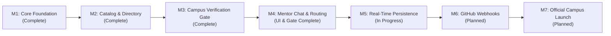

# BuildLab by I2IT — Engineering Roadmap & Development Plan

> **Author & Lead:** Ankit Pandey (Student Founder & Product Lead)  
> **Status:** Phase 0–3 Complete & Deployed; Phase 4–5 in Active Development  
> **Repository:** `https://github.com/ankitpandey1900/BuildLab_By-I2IT`  
> **Philosophy:** Make it real first, make it rock-solid, then make it beautiful. No fake features, no mock-only placeholders, no broken promises.

---

## What We Have Built So Far

BuildLab is the official open-source campus engineering platform for **Hope Foundation's International Institute of Information Technology (I2IT), Pune**.

We have completed the core foundation:
1. **Brand & Design Identity:**
   - Official brand identity: **BuildLab by I2IT**.
   - Custom brand asset (`/icon.webp`) integrated across navigation headers, dialogs, favicons, and landing components.
   - Clean, modern dark UI using Linear-inspired surface tokens, crisp border styling, and zero clashing neon accents.
2. **Campus Identity Verification Gate (Pivot from I2IT Domain Email to GitHub + PRN):**
   - **Why we removed forced college email logins:** Initially, Phase 1 considered forcing users to authenticate via official `@isquareit.edu.in` / `@i2it.ac.in` domain emails. We officially deprecated that approach: institutional inboxes are rarely checked daily, automated email links frequently get delayed or hit spam filters, and forcing passwords breaks the natural GitHub-first developer flow.
   - **The New Architecture:**
     - Open GitHub OAuth sign-in allows any student to immediately connect their real developer profile and explore projects without a login wall.
     - To perform sensitive community actions (claim issues, pitch solutions, post repositories, or message mentors), users complete the Campus Verification Gate:
       - **Students:** Full Name, University PRN, College Roll Code, Academic Year (FE, SE, TE, BE), and Department.
       - **Faculty / Mentors:** Full Name, College Employee Code, Academic Designation, and Department.
     - Admins review and approve submissions in the Verification Desk against official college records.
   - Strict department scope limited to the 3 engineering branches at I2IT:
     1. Computer Engineering
     2. Information Technology
     3. Electronics & Telecommunication
3. **Admin Campus Verification Desk:**
   - Dedicated administrative workspace (`/dashboard` -> Admin Desk tab).
   - Real-time search across student PRNs, employee codes, and roll numbers.
   - One-click approvals (`Approve Student` / `Approve Faculty`).
   - One-click revision requests (`Request Changes`) with custom feedback reasons.
4. **Project Catalog & Directory:**
   - Database-backed project listing with real-time category, maturity, and department filtering.
   - Support for idea-stage projects, hackathon prototypes, and BE final-year projects.
   - Task breakdown board with "Good First Issue" tags and suggested file paths for junior contributors.
5. **Collaboration Pitch Engine:**
   - Structured pitch modal allowing students to propose solutions to maintainers.
   - Maintainer inbox with accept, decline, and change-request options.
6. **1-on-1 Mentor Consultation Chat:**
   - Dedicated consultation modal gated to verified campus members.
   - Topic-driven discussions (Architecture, PR Reviews, Tech Stack, Issue Implementation).
7. **Institutional Support Review Workspace:**
   - Formal application process for projects seeking official college organization backing.

---

## Current Architecture & Tech Stack

- **Framework:** Next.js 16.4 (App Router, Turbopack, React 19)
- **Database:** PostgreSQL 16 hosted on Supabase (configured with separate transaction and session poolers)
- **ORM:** Prisma 6.19 with automated migrations and custom seed scripts
- **Type Safety:** TypeScript 5.7 running in strict mode (`npm run typecheck` produces 0 errors)
- **Styling:** Utility-first Tailwind CSS 3.4 with custom theme tokens
- **Auth Layer:** Better Auth foundation with dev bypass mode for rapid local feature development

---

## Roadmap & Backlog for Collaborators

Here is the exact breakdown of features ready for friends and team contributors to work on:

### Task Track 1: Real-Time 1-to-1 Mentor Chat Persistence (Backend & Realtime)
- **Current State:** The mentor chat modal simulates instant replies in-memory.
- **What Needs to Be Built:**
  1. Add a `MentorMessage` model to `prisma/schema.prisma` (`id`, `projectId`, `senderId`, `receiverId`, `topic`, `content`, `createdAt`).
  2. Implement an API route `/api/projects/[id]/mentor-messages` to fetch message history and send new messages.
  3. Integrate server-sent events (SSE) or Supabase Realtime so chat updates live without page refreshes.
  4. Ensure unverified users cannot bypass API routes even if sending raw POST requests.

### Task Track 2: GitHub Webhooks & Contribution Receipts (GitHub Trust Layer)
- **Current State:** Projects link to GitHub URLs and track repository metadata manually.
- **What Needs to Be Built:**
  1. Set up GitHub Webhook listener at `/api/github/webhooks`.
  2. Verify payload HMAC SHA-256 signatures using `GITHUB_WEBHOOK_SECRET`.
  3. On `pull_request.closed` (where `merged == true`), extract the student's GitHub username, match it to their verified PRN, and generate a `VerifiedContribution` receipt in the database.
  4. Display verified commits with badges on the student's public profile.

### Task Track 3: Senior-to-Junior Project Handover Wizard (Campus Sustainability)
- **Current State:** Stalled or graduating projects have an API stub for handover requests.
- **What Needs to Be Built:**
  1. Build a multi-step **Handover Wizard** in the Project Detail view.
  2. Allow graduating BE seniors to nominate junior maintainers from SE/TE.
  3. Generate a checklist: README quality, setup documentation, environment configuration, open issues, and GitHub repository admin transfer.
  4. Send automatic handover notifications to the new maintainers.

### Task Track 4: Mobile Experience & Navigation Polish (Frontend UI/UX)
- **Current State:** Desktop navigation is pristine; mobile devices use responsive stacking.
- **What Needs to Be Built:**
  1. Add a slide-out mobile drawer for navigation tabs (`Projects`, `Collaborate`, `Admin Desk`, `Profile`).
  2. Polish modal touch interactions so scrolling inside modals on small mobile screens feels native and smooth.
  3. Audit light-mode and amber-mode color tokens across all newly created verification and mentor dialogs.

---

## Step-by-Step Guide for New Contributors

If you are joining to build on this codebase, follow these steps:

1. **Clone the repository:**
   ```bash
   git clone https://github.com/ankitpandey1900/BuildLab_By-I2IT.git
   cd BuildLab_By-I2IT
   ```

2. **Install dependencies:**
   ```bash
   npm install
   ```

3. **Configure local environment:**
   - Copy `.env.example` to `.env`.
   - Update `DATABASE_URL` with your local PostgreSQL or Supabase connection string.

4. **Synchronize the database:**
   ```bash
   npx prisma db push
   npx prisma generate
   ```

5. **Start the development server:**
   ```bash
   npm run dev
   ```
   Open `http://localhost:3000` to start developing.

6. **Verify before opening a PR:**
   Always run both checks before submitting code:
   ```bash
   npm run typecheck
   npm run build
   ```
   Both commands must exit with code 0 with zero errors.

---

## Delivery Milestones



| Milestone | Scope | Status |
|---|---|---|
| **M1: Core Foundation** | Next.js 16 setup, PostgreSQL database, Prisma ORM, theme system | **Complete** |
| **M2: Directory & Catalog** | Project creation, roadmaps, task boards, filters, search | **Complete** |
| **M3: Campus Verification Gate** | PRN & Faculty verification, department restrictions, Admin Verification Desk | **Complete** |
| **M4: 1-on-1 Mentor Chat** | Consultation modal, topic selection, mentor routing | **UI & Gate Complete; DB Persistence Next** |
| **M5: Real-time Messaging** | PostgreSQL chat storage, live notifications, real-time sync | **In Progress** |
| **M6: GitHub Webhook Verification** | Webhook verification, commit receipts, cryptographic student portfolios | **Planned** |
| **M7: Official Campus Deployment** | Handover wizard, staging on college infrastructure, student rollout | **Planned** |
