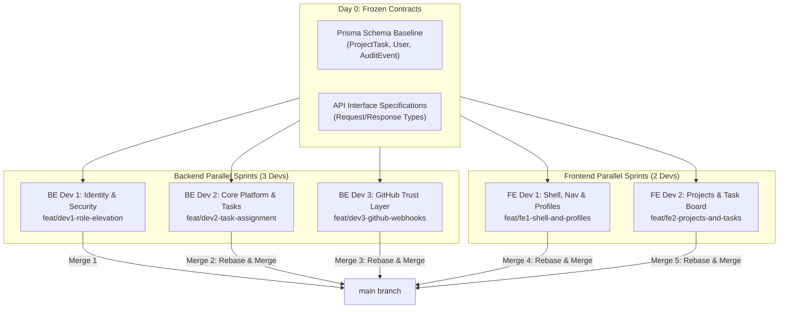
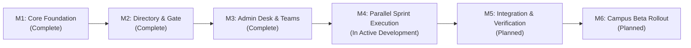

# BuildLab by I2IT — Engineering Roadmap & Development Plan

> **Author & Lead:** Ankit Pandey (Student Founder & Product Lead)  
> **Status:** Phase 0–3 Complete & Deployed; Phase 4–5 in Active Development  
> **Repository:** `https://github.com/ankitpandey1900/BuildLab_By-I2IT`  
> **Philosophy:** Make it real first, make it rock-solid, then make it beautiful. No fake features, no mock-only placeholders, no broken promises.

---

## 1. What We Have Built So Far

BuildLab is the official open-source campus engineering platform for **Hope Foundation's International Institute of Information Technology (I2IT), Pune**.

The core foundation is fully operational, verified, and backed by a live PostgreSQL database:

1. **Brand & Design Identity:**
   - Official brand identity: **BuildLab by I2IT**.
   - Custom brand asset (`/icon.webp`) integrated across navigation headers, dialogs, favicons, and landing components.
   - Clean, modern dark UI using Linear-inspired surface tokens, crisp border styling, and zero clashing neon accents.

2. **Campus Identity Verification Gate (GitHub + PRN Architecture):**
   - **Architectural Rationale:** Institutional email logins (`@isquareit.edu.in`) were deprecated because campus inboxes are rarely checked daily, automated email links frequently trigger spam filters, and forcing passwords breaks the natural GitHub-first developer flow.
   - **Open GitHub OAuth:** Students immediately connect their real GitHub profile and explore repositories without a login wall.
   - **Campus Verification Gate:** To perform sensitive community actions (claim issues, pitch solutions, post repositories, or message mentors), users complete the verification gate:
     - **Students:** Full Name, University PRN, College Roll Code, Academic Year (FE, SE, TE, BE), and Department.
     - **Faculty / Mentors:** Full Name, College Employee Code, Academic Designation, and Department.
   - Strict department scope limited to the 3 engineering branches at I2IT:
     1. Computer Engineering
     2. Information Technology
     3. Electronics & Telecommunication

3. **Production-Grade Admin Verification Desk (Phases A–D):**
   - Dedicated administrative workspace (`/dashboard` -> Admin Desk tab) restricted to `admin`, `faculty`, `reviewer`, and `lead` roles.
   - **Dual Views:** Seamless toggle between visual Card Grid and dense data Table views.
   - **College Registrar Roster Auto-Matcher:** CSV parser that pre-approves verified enrolled students by cross-referencing college registrar lists with PRN and full name confidence matching.
   - **Multi-Select Batch Operations:** Bulk approve or reject submissions in a single transactional round-trip via `/api/admin/verifications/batch`.
   - **Immutable Audit Logging:** Every administrative mutation writes to `AuditEvent` via `/api/admin/verifications/audit`, capturing reviewer ID, action, timestamp, client IP, and user-agent metadata.
   - **Accreditation Export:** One-click CSV export structured for official NAAC and NBA college accreditation compliance.
   - **Contributor Evidence Inspector:** Dialog for inspecting candidate GitHub profiles, PR evidence, and college credentials side-by-side.

4. **Faculty & Student Teams Showcase (`/teams`):**
   - Interactive campus showcase featuring college faculty mentors, technical advisors, and student leadership.
   - Interactive 3D perspective card tilt on hover, responsive mentor carousels, and department chips.

5. **Project Catalog & Directory:**
   - Database-backed project listing with real-time category, maturity, and department filtering.
   - Support for idea-stage projects, hackathon prototypes, and BE final-year projects.
   - Task breakdown board with "Good First Issue" tags and suggested file paths for junior contributors.

6. **Collaboration Pitch Engine:**
   - Structured pitch modal allowing students to propose solutions to maintainers.
   - Maintainer inbox with accept, decline, and change-request options.

7. **1-on-1 Mentor Consultation Chat:**
   - Dedicated consultation modal gated to verified campus members.
   - Topic-driven discussions (Architecture, PR Reviews, Tech Stack, Issue Implementation).

8. **Institutional Support Review Workspace:**
   - Formal application process for projects seeking official college organization backing.

9. **Day-0 Shared Database Synchronization:**
   - `model ProjectTask` extended in Prisma with `assigneeId String?`, `issueUrl String?`, and `assignee User?` relation.
   - `model User` extended with `assignedTasks ProjectTask[]`.
   - Schema pushed to Supabase PostgreSQL and Prisma Client generated for strict end-to-end type safety.

---

## 2. Current Architecture & Tech Stack

- **Framework:** Next.js 16.4 (App Router, Turbopack, React 19)
- **Database:** PostgreSQL 16 hosted on Supabase (configured with separate transaction pooler on port 6543 and session pooler on port 5432)
- **ORM:** Prisma 6.19 with automated migrations, schema locking, and custom seed scripts
- **Type Safety:** TypeScript 5.7 running in strict mode (`npm run typecheck` produces 0 errors)
- **Styling:** Utility-first Tailwind CSS 3.4 with custom theme tokens
- **Auth Layer:** GitHub OAuth with campus verification gating and session-based role elevation

---

## 3. Parallel Team Development Strategy & Track Assignments

To ensure high-velocity delivery without merge conflicts, development is partitioned into **3 Backend Tracks** and **2 Frontend Tracks**. 

### Engineering Coordination Rules (Industry Standard)
1. **Contract-First Development:** Database schema (`prisma/schema.prisma`) and API JSON contracts are agreed upon and locked *before* implementation.
2. **Strict File Ownership:** Each developer operates exclusively within their assigned files. Shared utility modifications require team review.
3. **Branch Hygiene:** Developers branch off `main` using standard prefixes (`feat/devX-...` or `feat/feX-...`).
4. **Local Verification Gate:** Before opening any PR, developers must run and pass:
   ```bash
   npm run typecheck
   npm run build
   ```
5. **Linear Rebase & Zero-Conflict Merge Sequence:** Branches are rebased onto `main` and merged sequentially.



---

### Backend Track 1: Identity, Campus Verification & Security (Developer 1)

- **Owner:** Backend Developer 1
- **Assigned Feature Branch:** `feat/dev1-role-elevation`
- **Track Scope:** User identity lifecycle, campus PRN verification engine, role-based access control (RBAC), administrative governance, immutable audit logging, and official NAAC/NBA accreditation reporting.

#### File Ownership Boundaries
- **Files Allowed to Modify / Create:**
  - `src/lib/permissions.ts`
  - `src/lib/admin-caller.ts`
  - `src/app/api/auth/[...all]/route.ts`
  - `src/app/api/verification/apply/route.ts`
  - `src/app/api/verification/status/route.ts`
  - `src/app/api/admin/verifications/**`
  - `src/app/api/admin/users/[id]/role/route.ts` *(To Create)*
  - `src/app/api/admin/metrics/accreditation/route.ts` *(To Create)*
- **Files Strictly Protected (Do Not Modify):**
  - `src/app/api/projects/**`
  - `src/app/api/github/**`
  - `src/components/**`

#### Assigned Tasks & Technical Specifications

##### Task BE-1.1: Role Promotion & Elevation API
- **Endpoint:** `PATCH /api/admin/users/[id]/role`
- **File:** `src/app/api/admin/users/[id]/role/route.ts`
- **Purpose:** Allows system administrators to elevate verified campus members to privileged platform roles (`student`, `faculty`, `reviewer`, `lead`, `admin`).
- **Validation Schema (Zod):**
  ```ts
  const roleSchema = z.object({
    role: z.enum(["student", "faculty", "reviewer", "lead", "admin"]),
  });
  ```
- **Implementation Rules:**
  1. Authenticate caller using `getAdminCaller()`. Reject with `403 Forbidden` if caller role is not `admin`.
  2. Prevent self-demotion/self-mutation: if `params.id === admin.id`, return `400 Bad Request` (`"You cannot change your own admin role."`).
  3. Validate target user existence; return `404 Not Found` if missing.
  4. Perform atomic update via `prisma.user.update`.
  5. Record immutable audit log via `prisma.auditEvent.create` (`action: "ROLE_CHANGED"`, capturing previous role, new role, and admin ID).
  6. Dispatch in-app notification to the affected user via `prisma.notification.create`.
  7. Return `200 OK` with `{ success: true, updatedRole }`.
- **Pitfalls to Avoid:** Do not allow reviewers or leads to execute this endpoint; enforce `admin.role === "admin"`. Never mutate without logging to `AuditEvent`.

##### Task BE-1.2: NAAC / NBA Accreditation Metrics API
- **Endpoint:** `GET /api/admin/metrics/accreditation`
- **File:** `src/app/api/admin/metrics/accreditation/route.ts`
- **Purpose:** Aggregates real-time campus statistics for college audit bodies (NAAC, NBA) without crashing server memory.
- **Implementation Rules:**
  1. Validate caller is an authorized admin or faculty lead (`getAdminCaller()`).
  2. Perform database-level aggregation using Prisma `groupBy` and indexed `count()` operations:
     ```ts
     const userDistribution = await prisma.user.groupBy({
       by: ["department", "verificationStatus"],
       _count: { id: true },
     });
     const totalVerifiedContributions = await prisma.verifiedContribution.count();
     ```
  3. Format response department-wise:
     ```json
     {
       "totalStudents": 240,
       "verifiedStudents": 185,
       "byDepartment": {
         "Computer Engineering": { "verified": 90, "pending": 12 },
         "Information Technology": { "verified": 65, "pending": 8 },
         "Electronics & Telecommunication": { "verified": 30, "pending": 5 }
       },
       "totalVerifiedContributions": 412
     }
     ```
- **Pitfalls to Avoid:** Never load all users into memory via `prisma.user.findMany()` and count in JavaScript. Strictly use database `groupBy`.

---

### Backend Track 2: Core Platform, Projects & Team Formation (Developer 2)

- **Owner:** Backend Developer 2
- **Assigned Feature Branch:** `feat/dev2-task-assignment`
- **Track Scope:** Project lifecycle management, project task delegation (Good First Issues), task claiming workflows, collaboration requests, support applications, and senior-to-junior project handover execution.

#### File Ownership Boundaries
- **Files Allowed to Modify / Create:**
  - `src/lib/project-access.ts`
  - `src/app/api/projects/route.ts`
  - `src/app/api/projects/[id]/route.ts`
  - `src/app/api/projects/[id]/tasks/route.ts`
  - `src/app/api/projects/[id]/tasks/[taskId]/assign/route.ts` *(To Create)*
  - `src/app/api/collaboration-requests/**`
  - `src/app/api/support-applications/**`
  - `src/app/api/projects/[id]/handover/route.ts`
  - `src/app/api/projects/[id]/handover/accept/route.ts` *(To Create)*
- **Files Strictly Protected (Do Not Modify):**
  - `src/app/api/admin/**`
  - `src/app/api/github/**`
  - `src/lib/permissions.ts`

#### Assigned Tasks & Technical Specifications

##### Task BE-2.1: Atomic Task Claiming & Assignment API
- **Endpoint:** `PATCH /api/projects/[id]/tasks/[taskId]/assign`
- **File:** `src/app/api/projects/[id]/tasks/[taskId]/assign/route.ts`
- **Purpose:** Allows a verified student to claim an open "Good First Issue" or allows a project maintainer to assign an issue to a contributor.
- **Validation Schema (Zod):**
  ```ts
  const assignSchema = z.object({
    assigneeId: z.string().min(1),
  });
  ```
- **Implementation Rules:**
  1. Authenticate session caller. Caller or target assignee must have `verificationStatus === "VERIFIED"`.
  2. Fetch `ProjectTask` by `params.taskId`. Return `404 Not Found` if missing.
  3. Validate task status: if task already has an `assigneeId` and status is `IN_PROGRESS` or `COMPLETED`, return `409 Conflict` (`"Task is already assigned"`).
  4. Perform atomic update setting `assigneeId`, status to `IN_PROGRESS`, and `updatedAt`.
  5. Notify the project maintainer via `prisma.notification.create`.
  6. Return `200 OK` with updated task details.
- **Pitfalls to Avoid:** Do not allow unverified students to claim tasks. Ensure concurrent claims are guarded against race conditions.

##### Task BE-2.2: Senior-to-Junior Project Handover Acceptance API
- **Endpoint:** `POST /api/projects/[id]/handover/accept`
- **File:** `src/app/api/projects/[id]/handover/accept/route.ts`
- **Purpose:** Completes the sustainability cycle when a graduating BE senior transfers maintainer ownership of a campus repository to a nominated junior (SE/TE).
- **Implementation Rules:**
  1. Authenticate caller; ensure caller is the designated `nominatedMaintainerId` in the project's pending handover record.
  2. Execute an atomic transaction via `prisma.$transaction`:
     - Update `Project.ownerId` to caller's `id`.
     - Update graduating senior's project membership role to `ADVISOR` or `ALUMNI`.
     - Set `Project.handoverStatus` to `COMPLETED`.
     - Record immutable event in `AuditEvent` (`action: "PROJECT_HANDOVER_ACCEPTED"`).
  3. Send congratulatory notification to junior maintainer and handover confirmation to graduating senior.
  4. Return `200 OK` with `{ success: true, newOwnerId: caller.id }`.
- **Pitfalls to Avoid:** Never execute partial role switches outside a `prisma.$transaction`. Prevent non-nominated users from intercepting the handover.

---

### Backend Track 3: GitHub Integrations, Webhooks & Trust Layer (Developer 3)

- **Owner:** Backend Developer 3
- **Assigned Feature Branch:** `feat/dev3-github-webhooks`
- **Track Scope:** Real-time GitHub integration, cryptographic webhook signature verification, Pull Request merge ingestion, automated `VerifiedContribution` receipt generation, and college GitHub organization invitation automation.

#### File Ownership Boundaries
- **Files Allowed to Modify / Create:**
  - `src/lib/github-api.ts` *(To Create)*
  - `src/app/api/github/sync/route.ts`
  - `src/app/api/github/webhooks/route.ts`
  - `src/app/api/github/org-invite/route.ts` *(To Create)*
- **Files Strictly Protected (Do Not Modify):**
  - `src/app/api/admin/**`
  - `src/app/api/projects/**`
  - `src/lib/project-access.ts`

#### Assigned Tasks & Technical Specifications

##### Task BE-3.1: Cryptographic GitHub Webhook Listener & Contribution Receipts
- **Endpoint:** `POST /api/github/webhooks`
- **File:** `src/app/api/github/webhooks/route.ts`
- **Purpose:** Ingests live GitHub repository events, cryptographically verifies payloads, and generates verified contribution receipts for merged student pull requests.
- **Implementation Rules:**
  1. Extract `x-hub-signature-256` header from incoming request.
  2. Compute HMAC SHA-256 using raw payload buffer and `process.env.GITHUB_WEBHOOK_SECRET`. Use `crypto.timingSafeEqual` to prevent timing attacks. Reject invalid signatures with `401 Unauthorized`.
  3. Inspect `x-github-event`. If `pull_request` and `action === "closed"` and `pull_request.merged === true`:
     - Extract author GitHub username: `pull_request.user.login`.
     - Match username against `User.githubUsername` in PostgreSQL.
     - If user exists and `verificationStatus === "VERIFIED"`:
       - Create `VerifiedContribution` record:
         - `userId`: matched student ID.
         - `projectId`: matched project ID (from repository URL).
         - `prNumber`: `pull_request.number`.
         - `prTitle`: `pull_request.title`.
         - `prUrl`: `pull_request.html_url`.
         - `mergedAt`: `pull_request.merged_at`.
         - `linesAdded`: `pull_request.additions`.
         - `linesDeleted`: `pull_request.deletions`.
       - Create celebratory notification for the student.
  4. Return `200 OK` with `{ received: true, verified: true }`.
- **Pitfalls to Avoid:** Never read `req.json()` before verifying the signature—signature verification requires the unparsed raw request body buffer.

##### Task BE-3.2: Automated College GitHub Organization Inviter
- **Endpoint:** `POST /api/github/org-invite`
- **File:** `src/app/api/github/org-invite/route.ts`
- **Purpose:** Automatically invites verified students to the official I2IT campus GitHub organization (`I2IT-OpenSource` or configured org).
- **Implementation Rules:**
  1. Authenticate caller session; verify caller is `VERIFIED`.
  2. Check if student already received an invite (`user.githubOrgStatus === "INVITED"`).
  3. Use GitHub REST API / Octokit authenticated via `GITHUB_ORG_ADMIN_TOKEN`:
     `POST /orgs/{org}/invitations` with `{ invitee_id: user.githubId }`.
  4. Update `User.githubOrgStatus` to `INVITED`.
  5. Return `200 OK` with invite confirmation.
- **Pitfalls to Avoid:** Handle GitHub API rate limits gracefully with exponential backoff.

---

### Frontend Track 1: Shell, Mobile Nav, Collaboration Inbox & Profiles (FE Developer 1)

- **Owner:** Frontend Developer 1
- **Assigned Feature Branch:** `feat/fe1-shell-and-profiles`
- **Track Scope:** Global application responsive shell, slide-out mobile drawer, bottom navigation bar, student/faculty public profile view with verified badges, and the maintainer collaboration pitch inbox.

#### File Ownership Boundaries
- **Files Allowed to Modify / Create:**
  - `src/components/layout/Header.tsx`
  - `src/components/layout/Footer.tsx`
  - `src/components/layout/MobileNav.tsx` *(To Create)*
  - `src/components/profile/ProfileView.tsx` *(To Create)*
  - `src/components/collaboration/CollaborationInbox.tsx`
  - `src/components/verification/VerificationModal.tsx`
- **Files Strictly Protected (Do Not Modify):**
  - `src/components/projects/**`
  - `src/components/admin/**`
  - `src/app/api/**`

#### Assigned Tasks & Technical Specifications

##### Task FE-1.1: Mobile Navigation Drawer & Bottom Bar
- **Files:** `src/components/layout/Header.tsx`, `src/components/layout/MobileNav.tsx`
- **Purpose:** Provides a first-class mobile experience on smartphones and tablets, replacing cramped desktop headers with a native-feeling drawer and bottom bar.
- **Implementation Rules:**
  1. Implement a sticky bottom navigation bar visible only on `<md` breakpoints (Projects, Pitches, Admin Desk, Profile).
  2. Add slide-out drawer triggered from hamburger menu with active route indicators, theme toggles, and user badge.
  3. Ensure zero layout shifts when modals or drawers open.
  4. Audit touch target heights (minimum 44x44px per Apple Human Interface Guidelines).

##### Task FE-1.2: Verified Campus Member Public Profile View
- **File:** `src/components/profile/ProfileView.tsx`
- **Purpose:** Displays a student or faculty member's verified credentials, college branch, claimed tasks, and cryptographic GitHub contribution receipts.
- **Implementation Rules:**
  1. Prominently display verification status:
     - Verified: Green badge with checkmark and department name (`Computer Engineering`).
     - Pending: Amber badge (`Verification in Review`).
     - Unverified: Neutral badge (`External Contributor`).
  2. Display "Verified Campus Contributions" section with commit counts, PR links, and graduation year.
  3. Display "Assigned Good First Issues" section showing active work.
  4. Support clean skeleton loading states during fetch.

##### Task FE-1.3: Maintainer Collaboration Inbox UI
- **File:** `src/components/collaboration/CollaborationInbox.tsx`
- **Purpose:** Triage interface for project maintainers to review pitches, examine applicant GitHub profiles, and accept or decline collaboration proposals.
- **Implementation Rules:**
  1. Implement optimistic status updates so maintainers see instant feedback upon clicking Accept/Decline.
  2. Render clear rejection feedback dialog when maintainers request pitch revisions.
  3. Display applicant's campus verification badge and year directly on the pitch card.

---

### Frontend Track 2: Project Workflows, Task Board UI & Handover (FE Developer 2)

- **Owner:** Frontend Developer 2
- **Assigned Feature Branch:** `feat/fe2-projects-and-tasks`
- **Track Scope:** Project catalog filtering, project detail deep-dive view, interactive "Good First Issue" task claiming board, and senior-to-junior project handover wizard.

#### File Ownership Boundaries
- **Files Allowed to Modify / Create:**
  - `src/components/projects/ProjectList.tsx`
  - `src/components/projects/ProjectDetail.tsx`
  - `src/components/projects/ProjectTaskBoard.tsx` *(To Create)*
  - `src/components/projects/ProjectHandoverModal.tsx` *(To Create)*
- **Files Strictly Protected (Do Not Modify):**
  - `src/components/layout/**`
  - `src/components/profile/**`
  - `src/components/collaboration/**`
  - `src/app/api/**`

#### Assigned Tasks & Technical Specifications

##### Task FE-2.1: Multi-Facet Project Catalog Search & Filter
- **File:** `src/components/projects/ProjectList.tsx`
- **Purpose:** Real-time filtering across the repository directory by branch, maturity level, and open issue availability.
- **Implementation Rules:**
  1. Synchronize filters directly with URL search params (`?dept=IT&maturity=PROTOTYPE&hasGFI=true`) for shareable links.
  2. Multi-tag filter bar with chips for:
     - Department: All, CE, IT, ENTC.
     - Maturity: Idea, Prototype, Production, Archival.
     - Toggle: "Has Good First Issues".
  3. Include empty-state illustration when query returns 0 matching projects.

##### Task FE-2.2: Interactive "Good First Issue" Task Board
- **File:** `src/components/projects/ProjectTaskBoard.tsx`
- **Purpose:** Allows junior developers to browse available project tasks, read implementation hints, and claim an issue with one click.
- **Implementation Rules:**
  1. Render task cards with difficulty level, estimated hours, and suggested file paths.
  2. "Claim Task" button:
     - If user is unverified: trigger `VerificationModal` with notice.
     - If task is already claimed: show disabled button with assignee's avatar and username.
     - If open: trigger confirmation dialog and call `PATCH /api/projects/[id]/tasks/[taskId]/assign`.
  3. Optimistic UI update: immediately mark task as assigned upon confirmation.

##### Task FE-2.3: Senior-to-Junior Project Handover Wizard
- **File:** `src/components/projects/ProjectHandoverModal.tsx`
- **Purpose:** Multi-step wizard guiding graduating final-year BE maintainers through project handover to junior students.
- **Implementation Rules:**
  1. Step 1 (Documentation Check): Verify README, local setup docs, and license.
  2. Step 2 (Nominate Successor): Search and select verified SE/TE student by PRN or GitHub username.
  3. Step 3 (Transfer Execution): Confirm GitHub repository admin access handover and dispatch `POST /api/projects/[id]/handover/accept`.
  4. Clear progress stepper bar with error recovery on network failure.

---

## 4. Shared Contracts & Deterministic Integration Sequence

### 1. The Day-0 Database Contract (Locked in Prisma)
The schema has been extended and pushed to the Supabase PostgreSQL cluster:
```prisma
model ProjectTask {
  id          String   @id @default(cuid())
  projectId   String
  title       String
  description String
  status      String   @default("OPEN") // OPEN, IN_PROGRESS, COMPLETED
  difficulty  String   @default("EASY") // EASY, MEDIUM, HARD
  filePaths   String[] @default([])
  issueUrl    String?  // Direct GitHub Issue URL
  assigneeId  String?  // Assigned student user ID
  createdAt   DateTime @default(now())
  updatedAt   DateTime @updatedAt

  project  Project @relation(fields: [projectId], references: [id], onDelete: Cascade)
  assignee User?   @relation(fields: [assigneeId], references: [id], onDelete: SetNull)

  @@index([projectId])
  @@index([assigneeId])
}
```

### 2. Deterministic Integration & Merge Pipeline
To avoid merge conflicts, PRs must be integrated into `main` in the following sequence:

| Step | Branch | Track | PR Target | Rebase Command Before PR |
|---|---|---|---|---|
| **1** | `feat/dev1-role-elevation` | BE Dev 1 | `main` | `git fetch origin main && git rebase origin/main` |
| **2** | `feat/dev2-task-assignment` | BE Dev 2 | `main` | `git fetch origin main && git rebase origin/main` |
| **3** | `feat/dev3-github-webhooks` | BE Dev 3 | `main` | `git fetch origin main && git rebase origin/main` |
| **4** | `feat/fe1-shell-and-profiles` | FE Dev 1 | `main` | `git fetch origin main && git rebase origin/main` |
| **5** | `feat/fe2-projects-and-tasks` | FE Dev 2 | `main` | `git fetch origin main && git rebase origin/main` |

---

## 5. Step-by-Step Guide for New Contributors

Follow this exact protocol when implementing your assigned track:

1. **Clone & Setup:**
   ```bash
   git clone https://github.com/ankitpandey1900/BuildLab_By-I2IT.git
   cd BuildLab_By-I2IT
   npm install
   ```

2. **Configure Environment:**
   - Copy `.env.example` to `.env`.
   - Ensure `DATABASE_URL` and `DIRECT_URL` point to your assigned PostgreSQL instance.

3. **Create Assigned Feature Branch:**
   ```bash
   git checkout main
   git pull origin main
   git checkout -b feat/your-assigned-track
   ```

4. **Verify Baseline Before Writing Code:**
   ```bash
   npm run typecheck
   npm run build
   ```
   Both checks must pass cleanly.

5. **Implement Assigned Scope:**
   - Modify **only** files within your assigned ownership boundary.
   - Adhere strictly to the Zod schemas and HTTP response contracts.

6. **Rebase & Verify Before Opening PR:**
   ```bash
   git fetch origin main
   git rebase origin/main
   npm run typecheck
   npm run build
   git push origin feat/your-assigned-track
   ```

---

## 6. Delivery Milestones



| Milestone | Scope | Status |
|---|---|---|
| **M1: Core Foundation** | Next.js 16 setup, Supabase PostgreSQL, Prisma ORM, theme system, Better Auth | **Complete** |
| **M2: Directory & Gate** | Project creation, PRN verification gate, pitch engine, mentor consultation UI | **Complete** |
| **M3: Admin Desk & Showcase** | Batch approvals, CSV roster matcher, audit trails, NAAC export, `/teams` page | **Complete** |
| **M4: Parallel Team Sprints** | BE Tracks 1–3 (RBAC, Tasks, Webhooks) & FE Tracks 1–2 (Shell, Board, Handover) | **In Progress** |
| **M5: Integration & Contracts** | Rebase-and-merge sequence, end-to-end integration tests, type verification | **Planned** |
| **M6: GitHub Trust Verification** | Live repository webhook verification, commit receipts, automated org invites | **Planned** |
| **M7: Official Campus Launch** | Student rollout across CE, IT, ENTC departments at I2IT Pune | **Planned** |
