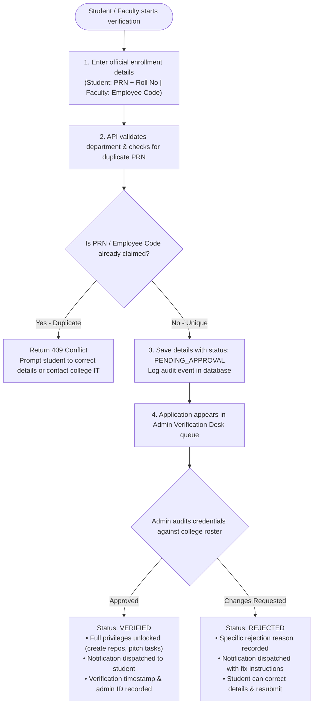
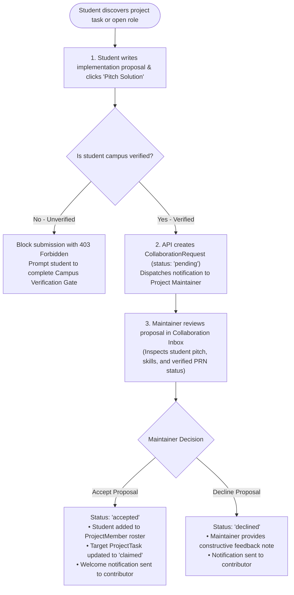
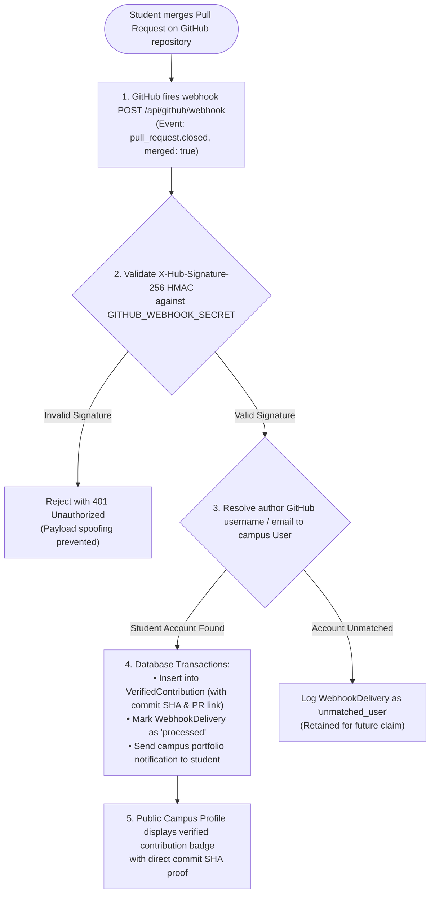

# System Architecture Document — BuildLab by I2IT

> **Author:** Ankit Pandey (Lead Architect & Product Lead)  
> **Status:** Active Baseline  
> **Target Audience:** Engineering team, systems reviewers, college IT, and open-source contributors  
> **Writing Standard:** Direct, technical, and precise. No corporate boilerplate. All diagrams and specifications reflect actual production code in this repository.

---

## 1. System Overview & Context

BuildLab by I2IT is a college-scoped engineering collaboration layer designed to solve the discovery, mentorship, and handover gap for student software projects at Hope Foundation's International Institute of Information Technology (I2IT), Pune.

The system does **not** replace Git hosting or issue trackers. GitHub is the single source of truth for code, commits, pull requests, and releases. BuildLab provides the community, verification, discovery, and governance layer on top of GitHub.

```mermaid
flowchart TD
    %% TIER 1: CLIENTS & ACTORS
    subgraph Clients ["1. Campus Users & Presentation Layer"]
        Student["Engineering Student<br/>(FE / SE / TE / BE)"]
        Faculty["Faculty / Mentor<br/>(CE / IT / E&TC)"]
        Reviewer["Campus Admin / Lead<br/>(Verification Desk)"]
    end

    %% TIER 2: NEXT.JS ENGINE
    subgraph Monolith ["2. BuildLab Fullstack Engine (Next.js 16 / Node.js 20+)"]
        WebUI["React 19 Interactive Shell (Tailwind CSS / Radix UI)"]
        AppRouter["App Router & Server Components (SSR / RSC)"]
        AuthModule["Better Auth Engine (Session Cookies & Middleware)"]
        APIRoutes["Domain API Handlers (/api/projects, /api/verification, /api/github)"]
        PrismaClient["Prisma 6.19 ORM Client (Type-Safe Query Engine)"]
    end

    %% TIER 3: PERSISTENCE
    subgraph Persistence ["3. Persistence & Database Layer (Supabase)"]
        Pooler["PgBouncer Transaction Pooler (Port 6543)"]
        DirectDB["Direct Session Connection (Port 5432)"]
        PostgresDB[("PostgreSQL 16 Primary DB<br/>(Users, Projects, PRNs, Receipts, Audits)")]
    end

    %% TIER 4: EXTERNAL INTEGRATIONS
    subgraph External ["4. External Ecosystem"]
        GitHubOAuth["GitHub OAuth 2.0 & REST API v3"]
        GitHubWebhook["GitHub Webhooks (HMAC SHA-256 Signatures)"]
    end

    %% FLOW CONNECTIONS
    Student -->|HTTPS / WSS| WebUI
    Faculty -->|HTTPS / WSS| WebUI
    Reviewer -->|HTTPS / WSS| WebUI

    WebUI -->|User Interactions / Hydration| AppRouter
    AppRouter -->|Session Check| AuthModule
    AppRouter -->|Data Mutations & Fetches| APIRoutes
    
    AuthModule <-->|OAuth Handshake & Token Refresh| GitHubOAuth
    GitHubWebhook -->|pull_request.closed Events| APIRoutes

    APIRoutes -->|Domain Queries| PrismaClient
    PrismaClient -->|Runtime Pool (DATABASE_URL)| Pooler
    PrismaClient -.->|Migrations (DIRECT_URL)| DirectDB
    
    Pooler --> PostgresDB
    DirectDB --> PostgresDB
```

---

## 2. Architectural Principles & Constraints

1. **Modular Monolith over Microservices:**  
   Given our campus user base (500–2,000 active students and faculty), a distributed microservices architecture would introduce unnecessary network latency, serialization overhead, and deployment complexity. We use a unified Next.js 16 modular monolith with clear domain boundaries.
2. **GitHub-First Source of Truth:**  
   Repositories, branches, commits, PRs, and raw git history live entirely on GitHub. We store metadata, relationships, tasks, pitches, and verified cryptographic receipts in PostgreSQL.
3. **Decoupled Verification from Authentication:**  
   Authentication is handled via GitHub OAuth. Verification is handled via our **Campus Verification Gate** (PRN/Roll No for students, Employee Code/Designation for faculty). This separation prevents friction during onboarding while preserving strict campus accountability.
4. **Zero-Trust Server Validation:**  
   All mutations, role checks, and status changes are verified on the server. Client-side state is treated as untrusted presentation data.

---

## 3. High-Level Component Decomposition

### 3.1 Presentation Layer (`src/components/` & `src/app/`)
- **App Router Shell:** Server components handle initial data hydration directly from Prisma for SEO and speed; interactive components (`"use client"`) handle client interactivity.
- **Design System:** Custom CSS variables adhering to Linear/GitHub dark-mode aesthetics (`var(--bg-canvas)`, `var(--bg-surface)`, `var(--border-default)`, `var(--accent-primary)`).
- **Core View Modules:**
  - `LandingPage.tsx`: Public platform showcase, project highlight cards, community workflow.
  - `ProjectList.tsx` / `ProjectDetail.tsx`: Searchable catalog with department, maturity, and category filters.
  - `StudentVerificationModal.tsx`: Dual-track campus verification modal (Student vs Faculty).
  - `AdminVerificationDesk.tsx`: Queue interface for approving PRNs and employee codes or requesting revisions.
  - `CollaborationModal.tsx` & `CollaborationInbox.tsx`: Proposal pitch interface and maintainer management inbox.
  - `MentorChatModal.tsx`: Topic-driven 1-on-1 consultation channel between verified students and mentors.
  - `SupportReviewerWorkspace.tsx`: Formal institutional sponsorship review desk.

### 3.2 Business Logic & API Layer (`src/app/api/`)
- `/api/verification/apply`: Validates incoming PRNs, employee codes, and departments; enforces unique constraints.
- `/api/admin/verifications/[id]`: Authorizes reviewer roles, executes state transitions (`VERIFIED` or `REJECTED`), logs audit events, and issues student notifications.
- `/api/projects/*`: Manages project creation, roadmaps, task boards, and repository metadata.
- `/api/collaboration-requests/*`: Manages proposal submissions, acceptances, and rejections.
- `/api/github/*`: Manages GitHub linking, health telemetry, and webhook ingestion.

### 3.3 Data Layer & Persistence (`prisma/` & Supabase)
- **Prisma Client:** Strict TypeScript query interface.
- **Dual Supabase Poolers:**
  - `DATABASE_URL`: Transaction mode pooler (PgBouncer on port 6543) for runtime queries, preventing connection spikes during high-concurrency campus events.
  - `DIRECT_URL`: Session mode pooler (port 5432) for Prisma schema migrations and DDL statements.

---

## 4. Key Workflows & Operational Data Flows

### 4.1 Campus Identity Verification Flow



---

### 4.2 Collaboration Proposal Flow



---

### 4.3 Verified Git Contribution Ingestion Flow



---

## 5. Security & Isolation Architecture

- **Session Authentication:** Handled via HTTP-only, secure, SameSite cookies managed by Better Auth.
- **CSRF Protection:** Next.js route handlers validate request origins and headers on mutating calls.
- **Least-Privilege Database Access:** Application runtime connects through an isolated database user without superuser or DDL drop permissions.
- **Secrets Management:** Credentials (`DATABASE_URL`, `BETTER_AUTH_SECRET`, `GITHUB_CLIENT_SECRET`) exist strictly on server environments and are never bundled into client JS.

---

## 6. Infrastructure & Deployment Topology

```mermaid
flowchart LR
    subgraph ClientZone ["Campus Client Zone"]
        Browser["Student / Faculty Browser<br/>(Chrome / Safari / Firefox)"]
    end

    subgraph IngressZone ["Ingress & Reverse Proxy"]
        EdgeProxy["Nginx / Cloudflare Edge<br/>(TLS 1.3 / Port 443 / SSL Termination)"]
    end

    subgraph AppZone ["Application Server Tier"]
        NodeServer["Next.js 16 Node.js Process<br/>(Standalone / PM2 / Turbopack Runtime)"]
    end

    subgraph DBZone ["Database & Persistence Tier (Supabase)"]
        PgBouncer["PgBouncer Transaction Pooler<br/>(Port 6543 / Max 50 conns)"]
        DirectPostgres[("PostgreSQL 16 Cluster<br/>(Port 5432 / Direct / Migrations)")]
    end

    subgraph GitHubZone ["External Services"]
        GitHubCloud["GitHub API & Webhook Service<br/>(REST v3 / HMAC SHA-256)"]
    end

    Browser -->|HTTPS / TLS 1.3| EdgeProxy
    EdgeProxy -->|Reverse Proxy / HTTP| NodeServer
    
    NodeServer -->|Runtime Queries (DATABASE_URL)| PgBouncer
    PgBouncer --> DirectPostgres
    NodeServer -.->|Prisma Migrations (DIRECT_URL)| DirectPostgres

    NodeServer <-->|OAuth 2.0 / API Calls| GitHubCloud
    GitHubCloud -->|Signed Webhooks| EdgeProxy
```

The system is fully portable and can run on:
1. **Self-Hosted Linux Node (College Campus Server):** Ubuntu 22.04 LTS managed via systemd/PM2 with Nginx reverse proxy.
2. **Cloud Container / Serverless Platform:** Vercel or Railway connected to Supabase PostgreSQL.
