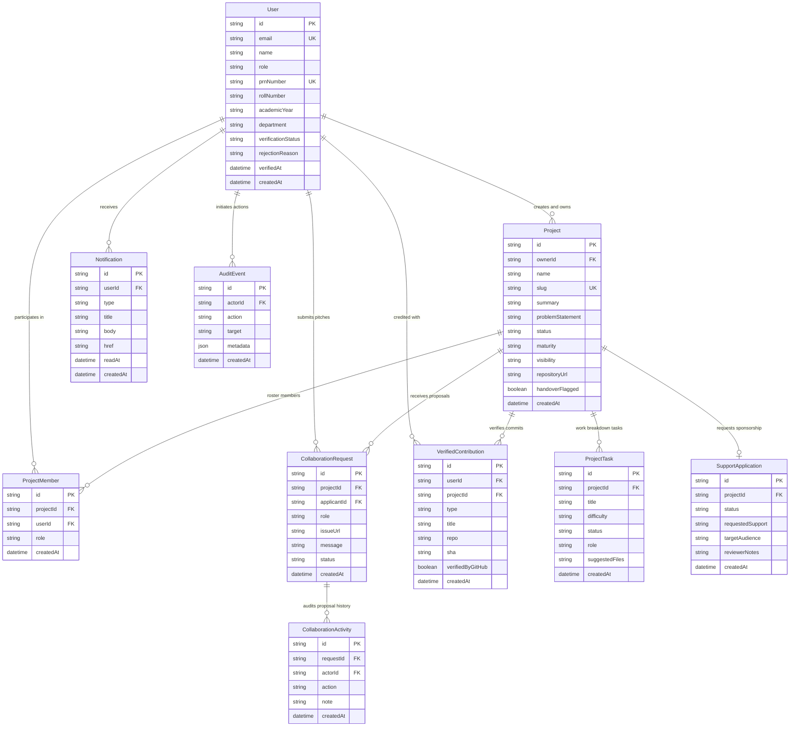
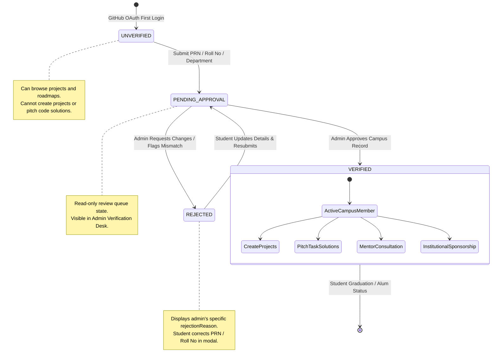
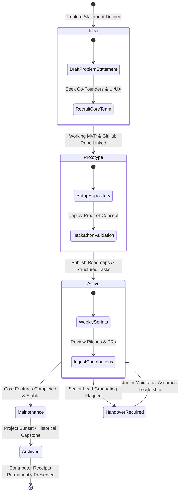
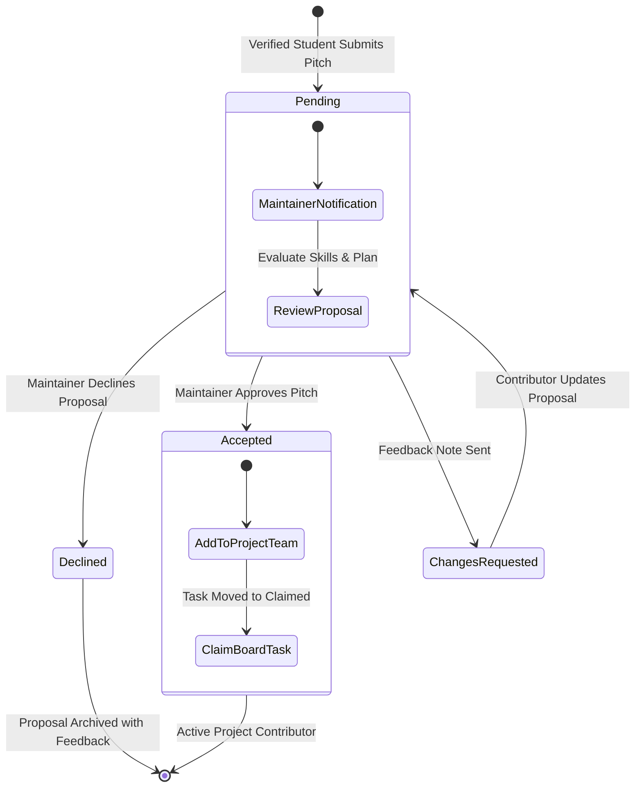
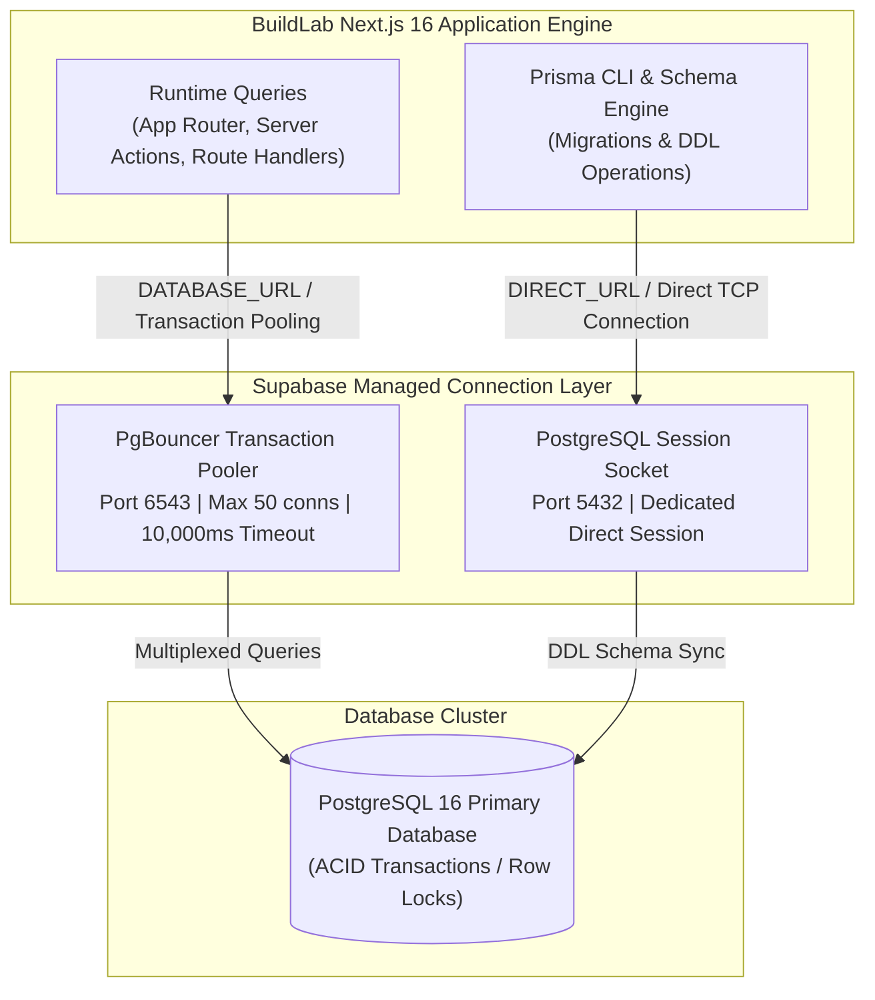

# System Design Document — BuildLab by I2IT

> **Author:** Ankit Pandey (Lead Architect & Product Lead)  
> **Status:** Active Baseline  
> **Target Audience:** Engineering team, database administrators, and technical contributors  
> **Scope:** Data models, state machines, API contracts, connection pooling, and security architecture.

---

## 1. Entity-Relationship Data Model

The database schema is defined in Prisma (`prisma/schema.prisma`) and hosted on PostgreSQL 16.



---

## 2. Core State Machines & Lifecycles

### 2.1 Campus Identity Verification Lifecycle

Every user record tracks a strict verification lifecycle managed by the campus gate:



- **`UNVERIFIED`:** Default state upon GitHub sign-in. User can browse projects, roadmaps, and public repos. Privileged actions prompt the verification modal.
- **`PENDING_APPROVAL`:** Credentials submitted to the review queue. User details are read-only while under review.
- **`VERIFIED`:** Credentials verified against official campus enrollment records. Full access granted: create projects, claim tasks, pitch solutions, talk 1-on-1 with mentors.
- **`REJECTED`:** Verification could not be verified (e.g., mismatched roll number or invalid checksum). Displays admin's `rejectionReason` with immediate option to correct and re-submit.

---

### 2.2 Project Maturity Lifecycle

Projects transition through discrete maturity stages as their technical foundation and team structure solidify:



- **`Idea`:** Problem statement defined. Zero code required. Focus is on finding co-founders, research partners, and UI/UX designers.
- **`Prototype`:** Working proof-of-concept or hackathon submission. Repository URL is required. Focus is on recruiting core contributors.
- **`Active`:** Established repository with structured task board, CI checks, and active maintenance.
- **`Maintenance`:** Stable utility or completed BE project. Focus on bug fixes, dependency updates, and minor enhancements.
- **`Archived`:** Read-only historical record. Contributions and receipts remain permanently preserved on contributor profiles.

---

### 2.3 Collaboration Pitch Lifecycle

Collaboration proposals follow a structured review pipeline between verified students and maintainers:



---

## 3. API Design & Endpoint Contracts

All API endpoints follow RESTful conventions and return standardized JSON payloads:

### 3.1 Verification Endpoints

#### `POST /api/verification/apply`
- **Authentication:** Required (session user)
- **Rate Limit:** 5 requests / 10 minutes per IP
- **Request Body:**
  ```json
  {
    "roleType": "student", // or "faculty"
    "fullName": "Aarav Sharma",
    "department": "Computer Engineering", // Strictly CE, IT, or E&TC
    "prnNumber": "72234012A", // or "employeeCode" for faculty
    "rollNumber": "TE-IT-42", // or "designation" for faculty
    "academicYear": "Third Year (TE)"
  }
  ```
- **Responses:**
  - `200 OK`: Verification submitted successfully.
  - `400 Bad Request`: Validation failure (missing required fields or invalid department).
  - `409 Conflict`: PRN / Employee Code already claimed by another user account.

#### `PATCH /api/admin/verifications/:id`
- **Authentication:** Required (User role must be `admin`, `faculty`, `reviewer`, or `lead`)
- **Request Body:**
  ```json
  {
    "action": "approve", // or "reject"
    "reason": "PRN checksum verified against campus records." // Required if reject
  }
  ```
- **Responses:**
  - `200 OK`: Status updated, audit event logged, and notification dispatched to student.
  - `403 Forbidden`: Caller lacks administrative review permissions.
  - `404 Not Found`: Target user record does not exist.

---

## 4. Database Connection & Scalability Strategy

To handle high concurrency during campus hackathons and project submissions without exhausting PostgreSQL connection limits, the data access layer implements a dual-connection pooler strategy:



### Indexing Strategy
- `User(prnNumber)`: B-tree index for instant duplicate PRN checks and admin desk lookups.
- `User(verificationStatus)`: Filter index for queue queries (`WHERE verificationStatus = 'PENDING_APPROVAL'`).
- `Project(visibility, archivedAt)`: Composite index for public directory filtering.
- `ProjectTask(projectId, status)`: Composite index for fast task board retrieval.

---

## 5. Security & Threat Modeling

| Threat Vector | Mitigation Strategy in BuildLab |
|---|---|
| **PRN Impersonation** | Unique database constraints prevent multiple accounts claiming the same PRN. Admin verification against campus records before privileged access is granted. |
| **Privilege Escalation** | All `/api/admin/*` routes verify role permissions on the server using session tokens; client state is never trusted. |
| **SQL Injection** | 100% of database interactions run through Prisma ORM using parameterized queries; zero raw dynamic SQL strings. |
| **Webhook Spoofing** | GitHub webhook listener verifies incoming `X-Hub-Signature-256` HMAC signatures using `GITHUB_WEBHOOK_SECRET` before processing events. |
| **XSS & Content Injection** | Markdown descriptions and README renderings sanitize HTML and disallow inline script executions. |
